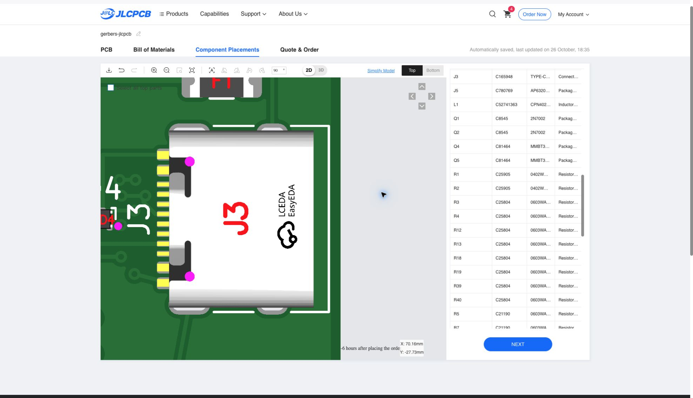

# V4.0 JLCPCB assembly corrections — 2026-10-26

Status: **DRAFT — corrected CPL reconciliation and final placement approval pending.**

This records the V4.0 assembly preparation for five boards and one separate
top-side stencil. V4.1 was the ANTS via revision; this package targets V4.0.

## BOM corrections

`jlc-bom.csv` contains all 77 fitted references and JLC upload headers:
`Comment,Designator,Footprint,JLCPCB Part #`.

| Reference | Original BOM entry | Order-specific selection | Reason |
| --- | --- | --- | --- |
| D8 | MPN `19-217/GHC-YR1S2/3T`, code `C2286` | `19-217/GHC-YR1S2/6T`, `C2986059` | Original code selected a red LED instead of the specified green 0603 LED. |
| D9 | MPN `19-217/BHC-ZL1M2RY/3T`, code `C2293` | `19-217/BHC-ZL1M2RY/6T`, `C2986058` | Original code selected an 0805 LED instead of the specified blue 0603 LED. |
| U2 | `CH340C`, `C84681` | `CH340C`, `C84681` | Retained the specified part; manually corrected the website's match to an unavailable alternate listing. |

JLC's assembly inventory showed 761,188 of C2986059, 1,798,306 of C2986058,
and 113,566 of C84681 during the October 26 session. These are historical
observations, not a stock guarantee. Recheck ready-for-assembly inventory
for the complete five-board BOM, including JLC's attrition requirements,
before reusing this package. Listing a part as Extended does not by itself
establish assembly availability.

Manufacturer references for the selected LEDs:

- [Green LED datasheet](https://www.everlighteurope.com/custom/files/datasheets/DSE-0025583.pdf)
- [Blue LED datasheet](https://www.everlighteurope.com/custom/files/datasheets/DSE-0014124.pdf)

## Placement changes recorded in the JLC viewer

- U1: corrected orientation, then moved down to align the side and bottom contacts.
- U2, U4, U6 and J5: corrected IC orientations against the board reference.
- J3: moved left to align the signal leads with the PCB pad row.
- J1/J2: retained their original positions; their bodies extend beyond the bottom edge in the source design.

The corrected arrangement was reopened from the saved cart and visually
checked. The screenshot below records J3's enlarged viewer alignment. It
does not replace numerical pin-coordinate or engineering verification.

**No corrected CPL is included here.** The repository's original
`../assembly-cpl.csv` and `../../exports/cpl.csv` have not been updated.
Neither the original CPL nor a header-only conversion of it reproduces the
saved viewer changes. No offsets have been inferred from screenshots.

## Requirements before this draft can become a reproducible assembly package

- Obtain the exact final JLC placement coordinates and rotations, including engineering corrections.
- Add a JLC CPL with `Designator,Mid X,Mid Y,Layer,Rotation` headers and millimetre coordinates.
- Verify exactly 77 unique references, matching this BOM, with all fitted parts on the top side and TP1/TP2/TP3 excluded.
- Re-upload the BOM and corrected CPL and verify that U1/U2/U4/U6/J5 orientations, U1 contact alignment, J3 leads and shell anchors, J1/J2 anchors, and diode/LED polarities reproduce the approved arrangement.
- Synchronize the canonical BOM/procurement metadata with the LED selections and regenerate affected manifests before declaring those canonical outputs current.
- Retain customer confirmation of PCB production files and final placement; the source project's physical bench-test hold still applies.

These additions preserve the original V4.0 engineering checkpoint. They do
not change board geometry, footprints, routing, Gerbers, or V4.1, and do not
claim physical qualification or production approval.
