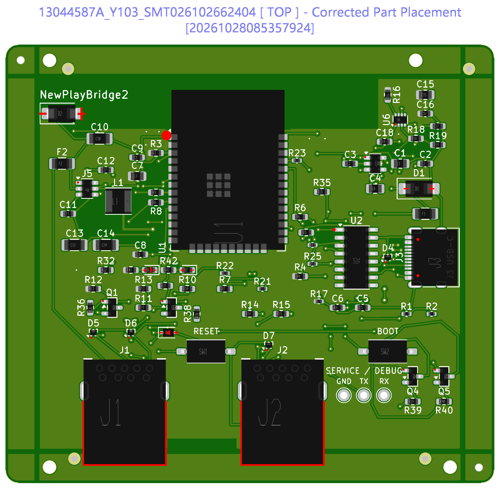
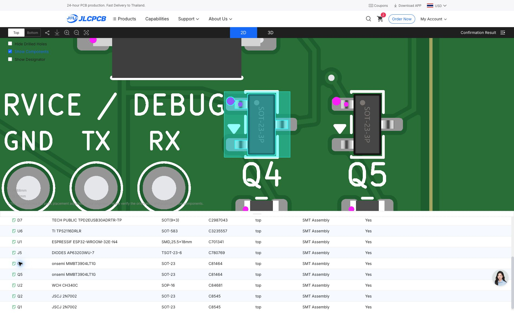

# V4.0 JLCPCB assembly corrections — 2026-10-26

Status: **DRAFT — prototype ordered; bare PCB file approved on October 28. Final CPL and assembly placement approval remain unresolved in the recorded session.**

This records the V4.0 assembly preparation for five boards and one separate
top-side stencil. V4.1 was the ANTS via revision; this package targets V4.0.

## BOM corrections

`jlc-bom.csv` contains all 77 fitted references and JLC upload headers:
`Comment,Designator,Footprint,JLCPCB Part #`.

| Reference | Original BOM entry | Order-specific selection | Reason |
| --- | --- | --- | --- |
| D8 | MPN `19-217/GHC-YR1S2/3T`, code `C2286` | `19-217/GHC-YR1S2/6T`, `C2986059` | Original code selected a red LED instead of the specified green 0603 LED. |
| D9 | MPN `19-217/BHC-ZL1M2RY/3T`, code `C2293` | `19-217/BHC-ZL1M2RY/6T`, `C2986058` | Original code selected an 0805 LED instead of the specified blue 0603 LED. |
| U2 | `CH340C`, `C84681` | `CH340C`, `C84681` | Retained the specified part; manually corrected the website's match to an unavailable alternate listing. |

JLC's assembly inventory showed 761,188 of C2986059, 1,798,306 of C2986058,
and 113,566 of C84681 during the October 26 session. These are historical
observations, not a stock guarantee. Recheck ready-for-assembly inventory
for the complete five-board BOM, including JLC's attrition requirements,
before reusing this package. Listing a part as Extended does not by itself
establish assembly availability.

Manufacturer references for the selected LEDs:

- [Green LED datasheet](https://www.everlighteurope.com/custom/files/datasheets/DSE-0025583.pdf)
- [Blue LED datasheet](https://www.everlighteurope.com/custom/files/datasheets/DSE-0014124.pdf)

## Recorded order and October 28 engineering review

See [`order-record.json`](order-record.json) for order identifiers and settings.
Five boards were ordered with Standard top-side assembly of all 77 references,
including wave soldering for J1/J2. JLC added handling rails/fiducials;
depaneling and rail removal before delivery were selected. One separate
frameless 380 × 280 mm top-side stencil was also ordered.

The bare PCB production file was explicitly confirmed on **2026-10-28**.
The review compared copper within the board window after accounting for
JLC's 5 mm handling rails, and checked 227 original round-hole locations
and eight routed slots. Copper comparison was a 600 dpi raster review
with a one-pixel tolerance (approximately 0.042 mm), not a formal netlist
equivalence or physical qualification test.
This confirmation did not approve component placement or qualify the design.
The last observed assembly stage was Data Finished (13%), with printing and
soldering still pending. This is a dated observation, not live order status.

JLC published a corrected top placement image on October 28 and flagged
13 revised references: R16, D4–D7, U6, U1, J5, Q4/Q5, U2 and Q1/Q2.
All 77 references were included and zero were marked unassembled.

### Q4/Q5 verification remains open

The corrected viewer and production image show the pin-1 marker at the
upper-left of Q4/Q5. Both the source PCB and the uploaded Gerber attributes
put pin 1/base at the lower-left, pin 2/emitter upper-left, and pin 3/collector
on the right (viewed from the top, with two pads on the left). This is a
**displayed marker discrepancy, not a confirmed assembly fault**.
JLC must verify the actual B/E/C mapping; do not guess a rotation change.
The [onsemi datasheet](https://www.onsemi.com/pdf/datasheet/mmbt3904lt1-d.pdf)
identifies pins 1/2/3 as base/emitter/collector.

| Reference | PCB pin 1 / base | PCB pin 2 / emitter | PCB pin 3 / collector |
| --- | --- | --- | --- |
| Q4 | DTR_BASE, (59.0625, 48.95) mm | CH340_RTS, (59.0625, 47.05) mm | ESP_EN, (60.9375, 48) mm |
| Q5 | RTS_BASE, (64.0625, 48.95) mm | CH340_DTR, (64.0625, 47.05) mm | ESP_BOOT, (65.9375, 48) mm |

Coordinates use the source KiCad board system; Y increases downward.
No engineering clarification or assembly-placement approval was sent during
the recorded review. A conditional-approval email was drafted in chat only.

## Placement changes recorded in the JLC viewer

- U1: corrected orientation, then moved down to align the side and bottom contacts.
- U2, U4, U6 and J5: corrected IC orientations against the board reference.
- J3: moved left to align the signal leads with the PCB pad row.
- J1/J2: retained their original positions; their bodies extend beyond the bottom edge in the source design.

The corrected arrangement was reopened from the saved cart and visually
checked. The screenshot below records J3's enlarged viewer alignment. It
does not replace numerical pin-coordinate or engineering verification.

**No corrected CPL is included here.** The repository's original
`../assembly-cpl.csv` and `../../exports/cpl.csv` have not been updated.
Neither the original CPL nor a header-only conversion of it reproduces the
saved viewer changes. No offsets have been inferred from screenshots.

## Requirements before this draft can become a reproducible assembly package

- Obtain the exact final JLC placement coordinates and rotations, including engineering corrections.
- Add a JLC CPL with `Designator,Mid X,Mid Y,Layer,Rotation` headers and millimetre coordinates.
- Verify exactly 77 unique references, matching this BOM, with all fitted parts on the top side and TP1/TP2/TP3 excluded.
- Re-upload the BOM and corrected CPL and verify that U1/U2/U4/U6/J5 orientations, U1 contact alignment, J3 leads and shell anchors, J1/J2 anchors, and diode/LED polarities reproduce the approved arrangement.
- Resolve the Q4/Q5 marker discrepancy with JLC and retain their mapping confirmation.
- LED MPN/LCSC fields are now synchronized across source PCB/schematic, circuit JSON, BOMs, shopping lists and textual manufacturing exports. The checksum manifest has been refreshed. The order-specific BOM remains the upload reference; the original CPL is still stale relative to JLC edits.
- Retain customer confirmation of PCB production files and final placement; the source project's physical bench-test hold still applies.

These additions preserve the original V4.0 engineering checkpoint. They do
not change board geometry, footprints, routing, Gerbers, or V4.1. LED
procurement metadata now matches the ordered parts. Bare PCB approval is
recorded separately from assembly approval and physical qualification.
